# PoC .NET - Polymorphic REST API

[](https://wakatime.com/badge/github/GuilhermeStracini/POC-dotnet-polymorphic-rest-api)
[](https://codeclimate.com/github/GuilhermeStracini/POC-dotnet-polymorphic-rest-api/maintainability)
[](https://codeclimate.com/github/GuilhermeStracini/POC-dotnet-polymorphic-rest-api/test_coverage)
[](https://www.codefactor.io/repository/github/GuilhermeStracini/POC-dotnet-polymorphic-rest-api)
[](https://github.com/GuilhermeStracini/POC-dotnet-polymorphic-rest-api)
[](https://github.com/GuilhermeStracini/POC-dotnet-polymorphic-rest-api)

🔬 Proof of Concept of a **Polymorphic REST API** with **.NET 8** and ASP.NET
Core.

A polymorphic REST API exposes a single endpoint that accepts and returns
objects of a **base type**, while the actual payload can be any of several
**derived types**. A **type discriminator** in the JSON (e.g. `"$type": "card"`)
tells the serializer which concrete class to bind to, so one contract can serve
many shapes of data.

---

## Table of contents

- [Project status](#project-status)
- [Tech stack](#tech-stack)
- [Repository layout](#repository-layout)
- [How it works today](#how-it-works-today)
  - [Request pipeline](#request-pipeline)
  - [Request lifecycle](#request-lifecycle)
  - [Domain model](#domain-model)
  - [Temperature conversion graph](#temperature-conversion-graph)
- [Target design: polymorphism](#target-design-polymorphism)
  - [Type hierarchy](#type-hierarchy)
  - [Polymorphic request flow](#polymorphic-request-flow)
  - [Deserialization decision](#deserialization-decision)
  - [Example payloads](#example-payloads)
- [Getting started](#getting-started)
- [Testing](#testing)
- [Quality gates & CI](#quality-gates--ci)
- [Contributing](#contributing)
- [Links](#links)

---

## Project status

> [!NOTE]
> The repository currently contains the **ASP.NET Core Web API scaffold** (the
> `WeatherForecast` sample). It already has hosting, Swagger, Docker, tests
> and CI in place.
> The polymorphic endpoints described in [Target design:
> polymorphism](#target-design-polymorphism) are the **planned** next step and
> are **not implemented yet**.

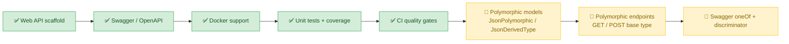

---

## Tech stack

| Concern         | Technology                                          |
| --------------- | --------------------------------------------------- |
| Runtime         | .NET 8 (`net8.0`), ASP.NET Core Web API             |
| API docs        | Swashbuckle.AspNetCore (Swagger UI in Development)  |
| Serialization   | `System.Text.Json`                                  |
| Containers      | Multi-stage `Dockerfile`, ports `8080` / `8081`     |
| Tests           | xUnit, FluentAssertions, NSubstitute, AutoFixture   |
| Coverage        | Coverlet                                            |
| Formatting      | CSharpier (local tool, pre-commit hook, CI linter)  |
| Static analysis | SonarCloud, DeepSource, CodeFactor, Code Climate    |

---

## Repository layout

```text
POC-dotnet-polymorphic-rest-api/
├── POCPolymorphicRestApi.sln
├── Src/
│   └── POCPolymorphicRestApi/
│       ├── Controllers/
│       │   └── WeatherForecastController.cs   # GET /WeatherForecast
│       ├── Properties/launchSettings.json     # Launch profiles
│       ├── Program.cs                         # Host + middleware
│       ├── WeatherForecast.cs                 # Response model
│       ├── POCPolymorphicRestApi.http         # Sample request
│       └── Dockerfile
├── Tests/
│   ├── Coverlet.runsettings
│   └── POCPolymorphicRestApi.Tests/
│       └── Controllers/WeatherForecastControllerTests.cs
├── .githooks/pre-commit                       # Branch name + format
├── .config/dotnet-tools.json                  # CSharpier local tool
└── .github/workflows/                         # CI pipelines
```

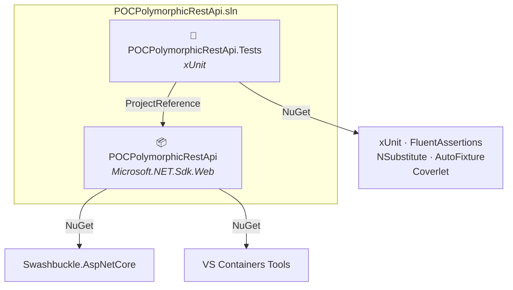

---

## How it works today

### Request pipeline

`Program.cs` builds a minimal ASP.NET Core host. Every request passes through
the middleware below, in this order:

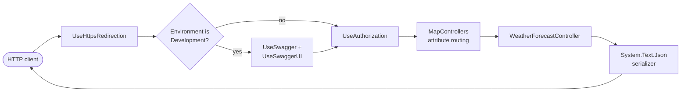

Services registered in the DI container:

| Registration                | Purpose                                     |
| --------------------------- | ------------------------------------------- |
| `AddControllers()`          | Controllers, model binding, JSON formatter  |
| `AddEndpointsApiExplorer()` | Endpoint metadata for OpenAPI               |
| `AddSwaggerGen()`           | Generates the OpenAPI document              |

### Request lifecycle

What happens for `GET /WeatherForecast`:

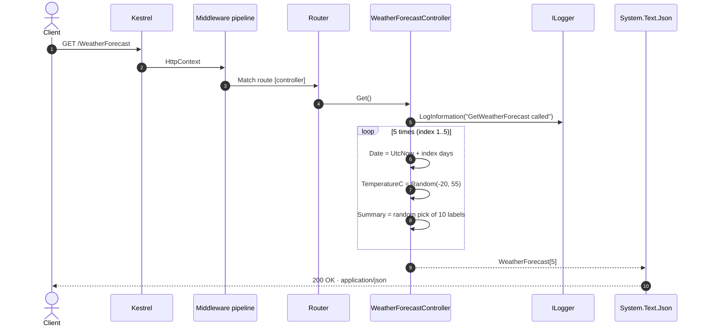

Example response:

```json
[
  {
    "date": "2026-11-16",
    "temperatureC": 21,
    "temperatureF": 69,
    "summary": "Mild"
  }
]
```

### Domain model

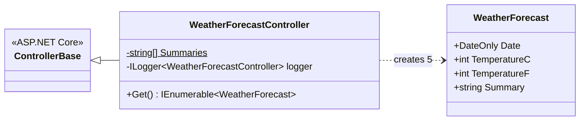

`TemperatureF` is a computed property: `32 + (int)(TemperatureC / 0.5556)`.

### Temperature conversion graph

`TemperatureC` is drawn from `Random.Shared.Next(-20, 55)`, so it ranges from
**-20 °C to 54 °C**. The graph shows what the API returns for `TemperatureF`
across that range, next to the exact value (`C × 9/5 + 32`):

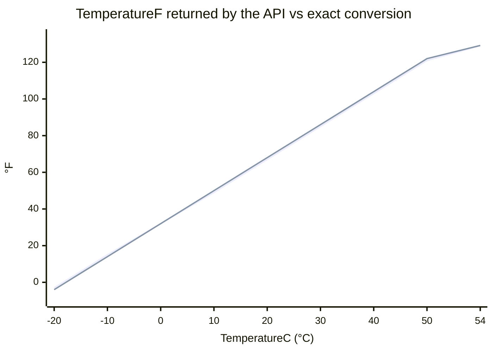

| °C   | API `TemperatureF` | Exact °F |
| ---- | ------------------ | -------- |
| -20  | -3                 | -4       |
| -10  | 15                 | 14       |
| 0    | 32                 | 32       |
| 10   | 49                 | 50       |
| 20   | 67                 | 68       |
| 30   | 85                 | 86       |
| 40   | 103                | 104      |
| 50   | 121                | 122      |
| 54   | 129                | 129.2    |

> [!TIP]
> The `(int)` cast truncates toward zero, so the result is often **1 °F off**.
> It is too low for positive temperatures and too high for negative ones. This
> comes from the stock template and is harmless for a PoC.

---

## Target design: polymorphism

> [!IMPORTANT]
> This section describes the **planned** implementation. It uses the built-in
> `System.Text.Json` polymorphism support (available since .NET 7), so no
> extra library is needed. The `Payment` domain below is only an example.

### Type hierarchy

The base type is annotated with `[JsonPolymorphic]` and lists every derived type
with `[JsonDerivedType]` and its discriminator value:

```csharp
[JsonPolymorphic(TypeDiscriminatorPropertyName = "$type")]
[JsonDerivedType(typeof(CardPayment), "card")]
[JsonDerivedType(typeof(PixPayment), "pix")]
[JsonDerivedType(typeof(BankTransferPayment), "bankTransfer")]
public abstract class Payment
{
    public Guid Id { get; set; }
    public decimal Amount { get; set; }
    public string Currency { get; set; }
}
```

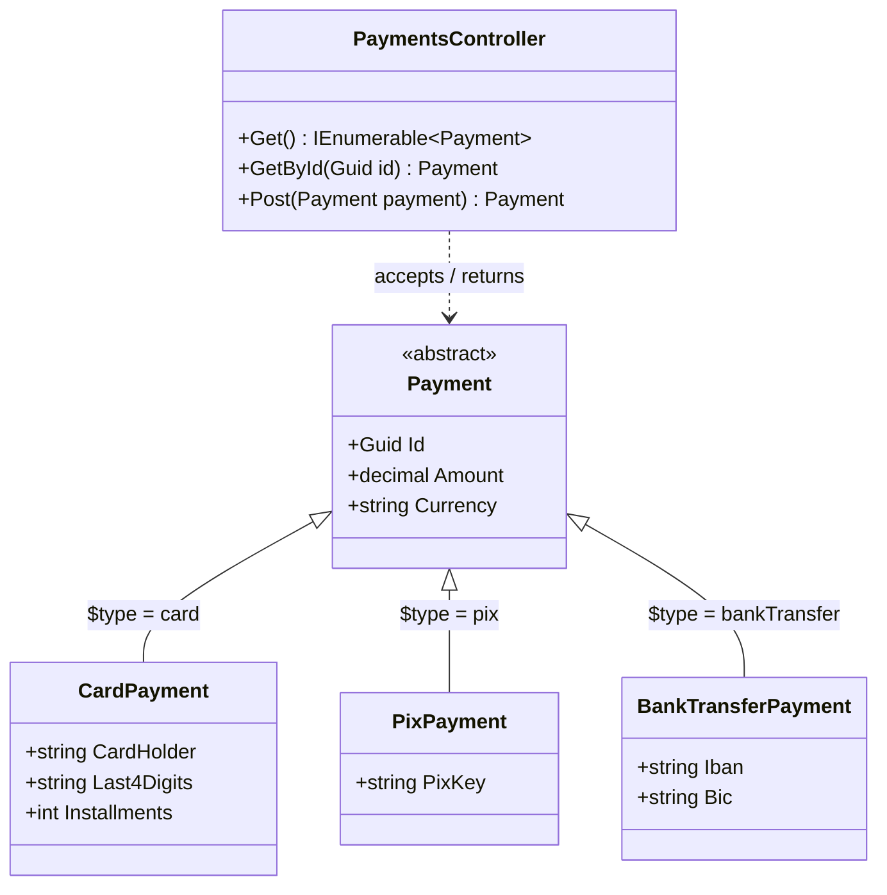

### Polymorphic request flow

One endpoint accepts the base type, and the runtime type decides how the payload
is handled:

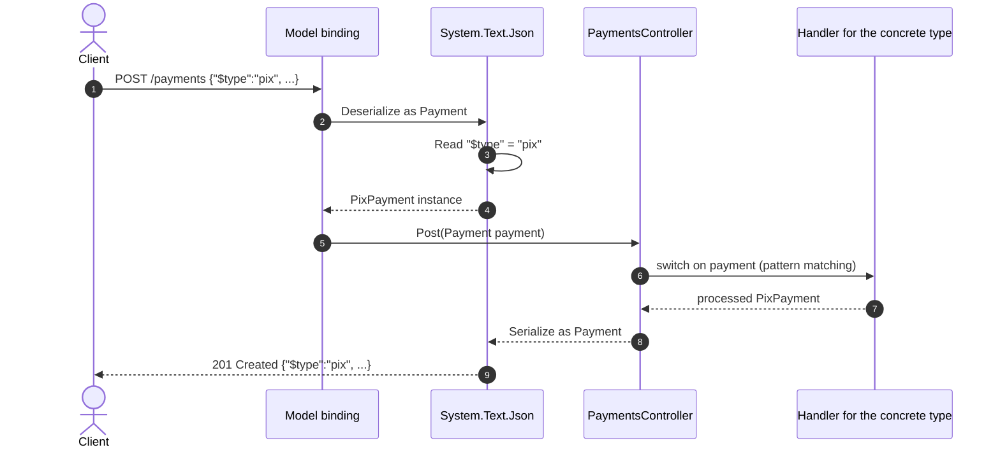

### Deserialization decision

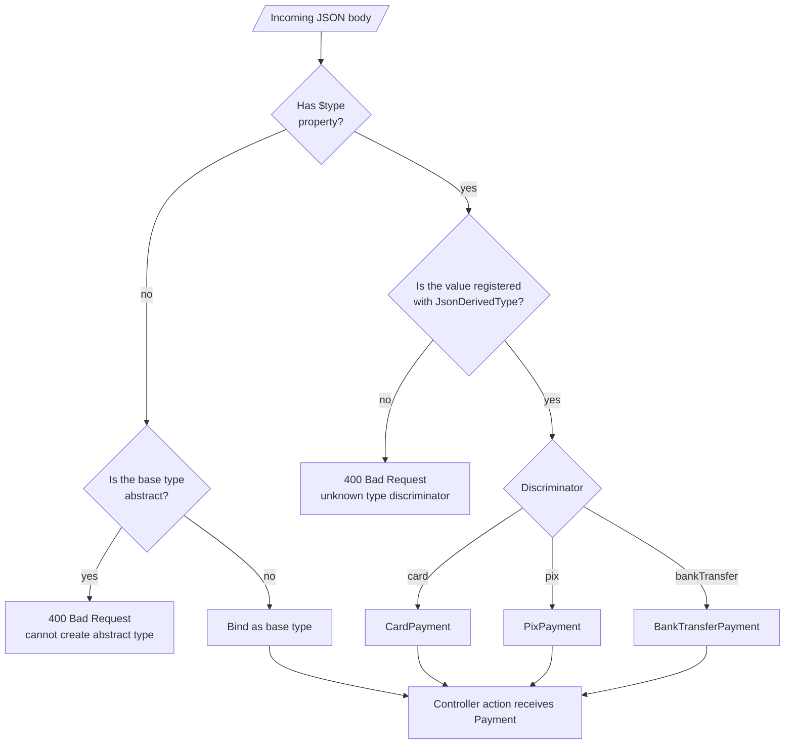

> [!WARNING]
> `System.Text.Json` expects the `$type` discriminator to be the **first
> property** in the JSON object by default. Starting with .NET 9 you can turn
> on `AllowOutOfOrderMetadataProperties` to accept it anywhere.

### Example payloads

#### Card payment

```json
{
  "$type": "card",
  "id": "8f7a2c4e-1b3d-4e5f-9a8b-7c6d5e4f3a2b",
  "amount": 199.9,
  "currency": "EUR",
  "cardHolder": "JANE DOE",
  "last4Digits": "4242",
  "installments": 3
}
```

#### Pix payment

```json
{
  "$type": "pix",
  "id": "1a2b3c4d-5e6f-7a8b-9c0d-1e2f3a4b5c6d",
  "amount": 50,
  "currency": "BRL",
  "pixKey": "jane@example.com"
}
```

#### Bank transfer

```json
{
  "$type": "bankTransfer",
  "id": "9e8d7c6b-5a4f-3e2d-1c0b-a9f8e7d6c5b4",
  "amount": 1200,
  "currency": "EUR",
  "iban": "IE29AIBK93115212345678",
  "bic": "AIBKIE2D"
}
```

---

## Getting started

### Prerequisites

- [.NET 8 SDK](https://dotnet.microsoft.com/download/dotnet/8.0)
- Optional: [Docker](https://www.docker.com/)

### Run locally

```bash
git clone https://github.com/GuilhermeStracini/POC-dotnet-polymorphic-rest-api.git
cd POC-dotnet-polymorphic-rest-api
dotnet run --project Src/POCPolymorphicRestApi --launch-profile https
```

| Profile       | URLs                                              |
| ------------- | ------------------------------------------------- |
| `http`        | `http://localhost:5021`                           |
| `https`       | `https://localhost:7258`, `http://localhost:5021` |
| `IIS Express` | `http://localhost:7324` (SSL port `44374`)        |

Swagger UI is served at `/swagger` on any of these URLs.

Try it with the bundled [`.http` file][http-file], or with curl:

```bash
curl http://localhost:5021/weatherforecast
```

### Run with Docker

The `Dockerfile` copies paths relative to `Src/`, so build from that folder:

```bash
cd Src
docker build -f POCPolymorphicRestApi/Dockerfile -t poc-polymorphic-rest-api .
docker run --rm -p 8080:8080 poc-polymorphic-rest-api
curl http://localhost:8080/weatherforecast
```

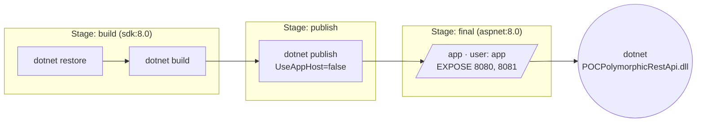

> Swagger UI is only enabled when `ASPNETCORE_ENVIRONMENT=Development`. Add
> `-e ASPNETCORE_ENVIRONMENT=Development` to `docker run` to get it inside the
> container.

---

## Testing

```bash
dotnet test
```

With coverage (Coverlet, OpenCover format):

```bash
dotnet test /p:CollectCoverage=true /p:CoverletOutputFormat=opencover
```

The tests use **xUnit** for the runner, **NSubstitute** to mock `ILogger<T>`,
and **FluentAssertions** for the assertions. `Program` is marked
`[ExcludeFromCodeCoverage]`, so coverage counts only the controller and model
code.

---

## Quality gates & CI

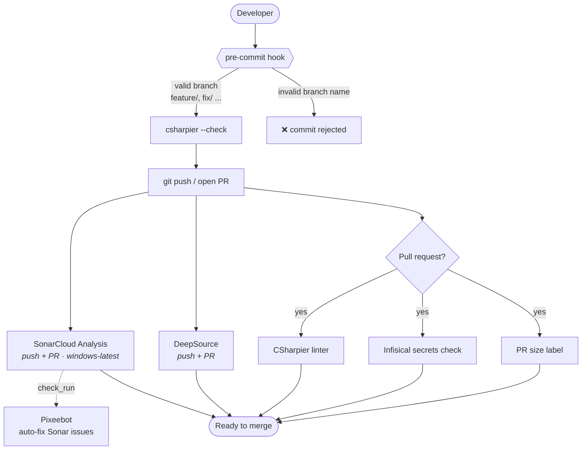

| Workflow                      | Trigger         | What it does               |
| ----------------------------- | --------------- | -------------------------- |
| `sonar-cloud.yml`             | push, PR        | Build, test, SonarCloud    |
| `deep-source.yml`             | push, PR        | Coverage to DeepSource     |
| `linter.yml`                  | PR, manual      | CSharpier format check     |
| `infisical-secrets-check.yml` | PR, manual      | Scans for leaked secrets   |
| `size-label.yml`              | PR              | Labels the PR by diff size |
| `sonarcloud-pixeebot.yml`     | Sonar check run | Pixeebot auto-fixes        |

---

## Contributing

1. Enable the repository hooks once: `git config core.hooksPath .githooks`
2. Restore local tools: `dotnet tool restore`
3. Name your branch with a conventional prefix: `feature/`, `fix/`, `docs/`,
   `style/`, `refactor/`, `perf/`, `hotfix/`, `test/`, `chore/` or `create/`
4. Format before committing: `dotnet csharpier .`
5. Open a pull request against `main`

---

## Links

- [References](https://blog.guilhermebranco.com.br/)
- [Polymorphic serialization with System.Text.Json][stj-polymorphism]
- [Swashbuckle.AspNetCore][swashbuckle]

## License

Distributed under the terms of the [LICENSE](LICENSE) file.

[http-file]: Src/POCPolymorphicRestApi/POCPolymorphicRestApi.http
[swashbuckle]: https://github.com/domaindrivendev/Swashbuckle.AspNetCore
[stj-polymorphism]:
https://learn.microsoft.com/dotnet/standard/serialization/system-text-json/polymorphism
